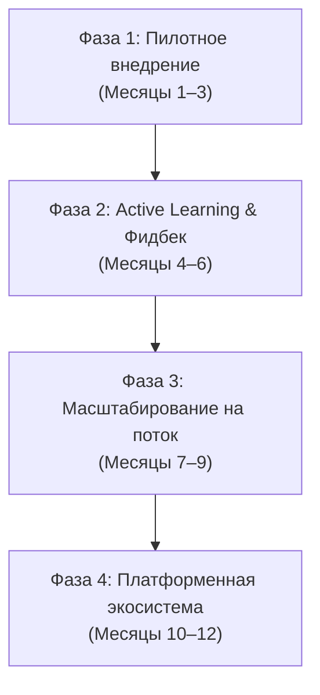
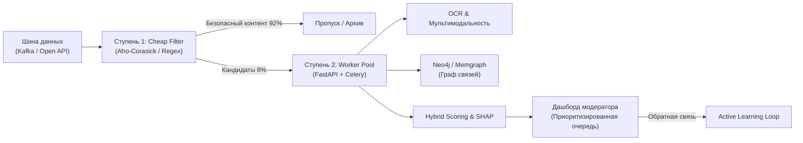

# ROADMAP.md — План внедрения и развития системы SafeNet KZ

## 1. Стратегическое видение
Трансформация прототипа SafeNet KZ в общегосударственную платформу автоматизированного мониторинга цифрового пространства РК для защиты граждан от сомнительных финансовых и гемблинг-схем в соцсетях и мессенджерах.

---

## 2. Фазы внедрения и развития

### Фаза 1: Пилотное внедрение и интеграция (Месяцы 1–3)
- **Партнерство и правовой контур:**
  - Заключение меморандумов о сотрудничестве с профильными ведомствами (АФМ РК, МИОР РК, АРРФР).
  - Развертывание защищенного контура SafeNet KZ в закрытой инфраструктуре (on-premise / QazCloud).
- **Подключение реальных источников:**
  - Настройка коннекторов к открытым API платформ (Telegram MTProto, Instagram Graph API, TikTok Research API).
  - Подключение доверенных каналов обращений граждан (чат-боты eGov / Telegram-бот АФМ).
- **Калибровка на реальном потоке:**
  - Валидация порогов на реальном региональном потоке (Шымкент, Алматы, Астана).

### Фаза 2: Активное обучение (Active Learning) и адаптация (Месяцы 4–6)
- **Цикл непрерывной обратной связи (Human-in-the-Loop):**
  - Использование кнопок модератора («Подтвердить» / «Ложное срабатывание») для пополнения обучающей выборки.
  - Автоматическая перекалибровка весов признаков при накоплении батча из 500+ проверенных решений.
- **Расширение языкового покрытия:**
  - Дообучение специализированной multilingual модели (Kazakh-BERT / KazRoBERTa) на размеченных модераторами текстах с региональным сленгом.
- **Углубленный ASR (Audio Speech Recognition):**
  - Подключение легковесной модели Whisper для транскрибирования аудиосообщений в голосовых чатах WhatsApp и прямых эфирах Instagram/TikTok.

### Фаза 3: Высоконагруженное масштабирование (Месяцы 7–9)
- **Двухступенчатая потоковая архитектура (Two-Stage Pipeline):**
  - **Ступень 1 (Cheap Filter):** легковесный regex- и Aho-Corasick фильтр на базе Rust/Go, обрабатывающий до 100 000 сообщений в секунду, отсекающий 92% заведомо безопасного трафика за $<1$ мс.
  - **Ступень 2 (Deep Scoring):** тяжелый мультимодальный OCR, графовый расчет и SHAP-объяснения запускаются асинхронно через брокер сообщений **Apache Kafka + Celery/Redis** только для потенциально рискованных кандидатов.
- **Миграция графовой базы данных:**
  - Переход с оперативной памяти `NetworkX` на распределенную графовую СУБД (**Neo4j** или **Memgraph**) для хранения связей между миллионами узлов в режиме реального времени.

### Фаза 4: Мониторинг дрейфа данных и кросс-ведомственное взаимодействие (Месяцы 10–12)
- **Мониторинг дрейфа концепта (Concept & Data Drift):**
  - Внедрение **Evidently AI** для отслеживания появления новых паттернов маскировки, сленговых терминов и аномальных скачков частотности доменов.
  - Автоматические алерты при снижении точности (Precision) ниже 95%.
- **Единый реестр признаков (Risk Intelligence Hub):**
  - Автоматическая передача хэшированных связей (номера карт, домены-зеркала) в банковские антифрод-системы (Kaspi, Halyk) для превентивной блокировки мошеннических дроп-счетов.

---

## 3. Архитектурная схема целевого решения (Production Target)

---

## 4. Оценка ресурсов и KPI масштабирования
- **Пропускная способность:** 50 млн сообщений/сутки при пиковой задержке скоринга $<150$ мс.
- **Целевая точность модерации:** Precision $\ge 98\%$, FPR $\le 0.5\%$.
- **Экономический эффект:** снижение нагрузки на ручных аналитиков на 85%, сокращение времени реакции на новые волны схем с 3–5 дней до 15 минут.